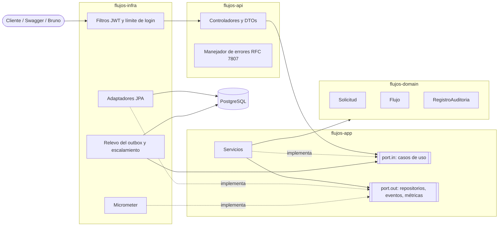

# Componentes

Las flechas de dependencia apuntan hacia el dominio. `flujos-api` solo ve `flujos-infra` en tiempo de ejecución, así que un controlador no puede importar un repositorio aunque quiera; lo que Maven no alcanza a impedir lo revisan las pruebas de ArchUnit ([ADR-001](../adr/ADR-001-arquitectura-hexagonal.md)).
