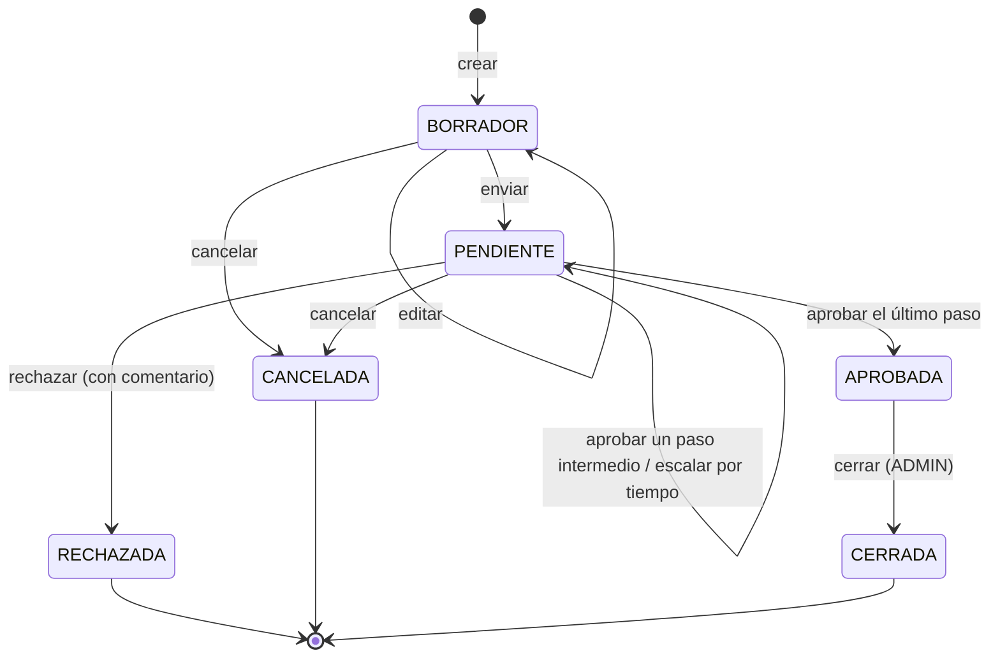

# Estados de una solicitud

- Una solicitud a la que no le aplica ningún paso del flujo pasa por `PENDIENTE` y queda `APROBADA` en la misma operación de envío. Es el caso de los gastos menores a 200.
- Escalar no cambia el estado: mueve la solicitud al paso siguiente, o avisa al ADMIN si ya estaba en el último.
- Cualquier acción que el estado actual no permite responde 409 con `estadoActual` ([ADR-005](../adr/ADR-005-409-vs-422.md)).
